  

# 📊 Awesome Cloud Spreadsheet Software

  
  
  
  
  
  

---

## 🌐 Comprehensive Ecosystem of Cloud Spreadsheets & Collaborative Grid Engines

> 🚀 **Curated directory of premier SaaS platforms, self-hostable collaborative engines, web spreadsheet SDKs, and developer-friendly open-source data grids.**  
> *Targeted at financial modelers, data engineers, operations analysts, and full-stack software architects.*

Cloud spreadsheet software eliminates the bottlenecks of legacy desktop software by enabling **browser-native real-time multi-user editing, automated API integrations, SQL/Python formula execution, and frictionless data sharing**. Whether you need an enterprise-grade managed SaaS platform or an open-source, air-gapped grid engine deployed via Docker, this guide covers the entire landscape.

---

## 📑 Table of Contents

- [📈 Sector Overview & Market Dynamics](#-sector-overview--market-dynamics)
- [☁️ SaaS / Hosted Cloud Spreadsheet Platforms](#-saas--hosted-cloud-spreadsheet-platforms)
- [🔓 Open-Source GitHub Projects & Engines](#-open-source-github-projects--engines)
- [🛠️ Architectural Recommendations](#-architectural-recommendations)
- [🤝 How to Contribute](#-how-to-contribute)
- [💖 Support](#-support)
- [⭐ Star History](#-star-history)
- [⚠️ Disclaimer](#-disclaimer)

---

## 📈 Sector Overview & Market Dynamics

The global spreadsheet software market is estimated at **$11.5 billion to $13.9 billion** and is projected to surpass **$20 billion by the early 2030s**, expanding at a steady CAGR of 5.3% to 7.5%. The market exhibits a **highly concentrated, winner-take-most structure at the enterprise foundation**—dominated by Microsoft 365 (Excel) and Google Workspace (Sheets)—while experiencing **moderate fragmentation across agile operational niches**, where modular relational databases (Airtable, Smartsheet), programmatic canvases (Coda, Rows), and privacy-first self-hosted open-source alternatives (NocoDB, Univer, Baserow, Grist) capture fast-growing developer and vertical enterprise adoption.

---

## ☁️ SaaS / Hosted Cloud Spreadsheet Platforms

The table below catalogs premier commercial cloud spreadsheet solutions, ranked in descending order by parent company market capitalization, valuation, or annual revenue scale.

| Product | Company Scale (Valuation / Revenue) | Description | Pricing (Starting Tier) | Free Tier / Trial Limits |
|:---|:---|:---|:---|:---|
| **[Apple Numbers for iCloud](https://www.icloud.com/)** | **~$3.5 Trillion** (Market Cap) | Canvas-centric cloud spreadsheet within iCloud. Features free-form canvas layout, 250+ built-in functions, interactive charts, and export to XLSX and PDF. | **Free** ($0 forever with Apple ID) | **Free Forever**: 5 GB shared iCloud storage, full web spreadsheet editor, unlimited sheets, real-time collaboration. |
| **[Microsoft Excel Online](https://www.microsoft.com/en-us/microsoft-365/excel)** | **~$3.1 Trillion** (Market Cap) | Browser-based edition of Microsoft Excel. Features real-time co-authoring, modern dynamic arrays, Power Query compatibility, and OneDrive sync. | **$6.00 / user / month** (Microsoft 365 Business Basic, billed annually) | **Free Forever**: Full web spreadsheet editor, 5 GB OneDrive cloud storage, real-time co-authoring, standard templates. |
| **[Google Sheets](https://sheets.google.com/)** | **~$2.2 Trillion** (Alphabet Market Cap) | Cloud-native collaborative spreadsheet within Google Workspace. Industry benchmark for live multi-user editing, Apps Script automation, and Gemini AI. | **$7.00 / user / month** (Business Starter, billed annually) | **Free Forever**: Full Google Sheets capabilities with 15 GB shared Google Drive storage for personal accounts; **14-day free trial** for Workspace Business plans. |
| **[Quip Spreadsheets](https://quip.com/)** | **~$300 Billion** (Salesforce Market Cap) | Salesforce-native collaborative document and spreadsheet suite with inline conversational chat, live Salesforce CRM bi-directional data sync, and mobile access. | **$10.00 / user / month** (Quip Starter, billed annually) | **30-day Free Trial**: Full access to collaborative documents, spreadsheets, and team chat (no permanent free tier). |
| **[Zoho Sheet](https://www.zoho.com/sheet/)** | **~$1.4 Billion+** (Annual Revenue) | Feature-dense cloud spreadsheet within Zoho Workplace. Includes Zia AI automated data insights, 350+ functions, automated data cleaning, and external API connectors. | **$3.00 / user / month** (Zoho Workplace Standard, billed annually; standalone web editor is $0) | **Free Forever**: Full standalone web & mobile spreadsheet editor with 5 GB Zoho Docs storage; **15-day free trial** for Zoho Workplace team plans. |
| **[Airtable](https://airtable.com/)** | **~$11.7 Billion** (Valuation) | Relational database-spreadsheet hybrid with grid, Kanban, Gantt, and gallery views, no-code relational data modeling, and workflow automation. | **$20.00 / seat / month** (Team Plan, billed annually) | **Free Forever**: Up to 1,000 records per base, 1 GB attachment storage per base, up to 5 editors, and 100 automation runs per month. |
| **[Smartsheet](https://www.smartsheet.com/)** | **~$8.4 Billion** (Acquisition Valuation) | Enterprise work execution and project tracking platform combining spreadsheet grids with Gantt milestones, resource allocation, and automated approvals. | **$9.00 / user / month** (Pro Plan, billed annually; max 10 users) | **30-day Free Trial**: Up to 50 active sheets, Business plan feature set, automated workflows, and dashboards without credit card required. |
| **[Coda](https://coda.io/)** | **~$1.4 Billion** (Valuation) | All-in-one collaborative doc and canvas with connected relational tables, interactive action buttons, formulaic automations, and custom third-party Packs. | **$10.00 / month per Doc Maker** (Pro Plan, billed annually; Editors & Viewers are free) | **Free Forever**: Unlimited unshared docs, unlimited editors/viewers, up to 50 table objects/doc, 1 GB file size per doc, and 7-day version history. |
| **[Rows](https://rows.com/)** | **~$50 Million+** (Total Raised) | Modern spreadsheet with 50+ built-in business integrations (OpenAI, Stripe, Google Analytics, Crunchbase), native JSON manipulation, and public web embed widgets. | **$6.00 / user / month** (Plus Plan, billed annually; or $8 billed monthly) | **Free Forever**: Unlimited spreadsheets, up to 3 guest collaborators, 10 integration accounts, 500 integration tasks/month, and 5 AI executions/month. |
| **[LibreOffice Calc Online](https://www.libreoffice.org/)** | **Non-Profit Foundation / Open-Source** (The Document Foundation) | Sovereign web spreadsheet powered by Collabora Online or open-source CODE deployment. Flawless ODF and XLSX compatibility with zero telemetry and total data isolation. | **€3.00 / user / month** (Collabora Online commercial production tier; self-hosted CODE is $0) | **Free Forever**: Completely free for on-premise personal and testing deployments via Collabora Online Development Edition (CODE) with Docker. |

---

## 🔓 Open-Source GitHub Projects & Engines

The following open-source spreadsheet engines, data grids, and self-hosted collaboration suites are ranked in descending order by **GitHub Stars_Count**. Each badge links directly to the project's stargazers community.

| Project | GitHub_Stars | Description |
|:---|:---:|:---|
| **[NocoDB](https://github.com/nocodb/nocodb)** |  | Open-source no-code platform turning PostgreSQL, MySQL, SQL Server, and SQLite into an intelligent collaborative spreadsheet. Top self-hosted Airtable alternative. |
| **[Univer](https://github.com/dream-num/univer)** |  | Full-stack, enterprise-grade open-source TypeScript SDK for spreadsheets, docs, and slides. High-performance canvas rendering with real-time multi-user editing. |
| **[Handsontable](https://github.com/handsontable/handsontable)** |  | High-performance JavaScript/TypeScript data grid with Excel look-and-feel. Features formula support, row filtering, virtual scrolling, and React/Angular/Vue components. |
| **[Luckysheet](https://github.com/dream-num/Luckysheet)** |  | Feature-packed online JavaScript spreadsheet mimicking Excel. Supports pivot tables, conditional formatting, chart generation, and multi-user collaboration. |
| **[x-spreadsheet](https://github.com/myliang/x-spreadsheet)** |  | Ultra-lightweight canvas-based web spreadsheet library built with vanilla JavaScript. Easy to integrate into web applications with cell styling and formula calculation. |
| **[Grist](https://github.com/gristlabs/grist-core)** |  | Open-source spreadsheet-database hybrid powered by standard Python formulas, cell-level access controls, SQLite storage, and live multi-user sync. |
| **[GridCraft](https://github.com/storytold/gridcraft)** |  | Clean-room, high-fidelity reimplementation of Microsoft Excel in pure Rust. Implements over 500 standard worksheet formulas with native XLSX, XLSB, and ODS import. |
| **[ONLYOFFICE Docs](https://github.com/ONLYOFFICE/DocumentServer)** |  | Enterprise-grade self-hosted office suite featuring online spreadsheet editing with strict OOXML (XLSX) fidelity, real-time collaboration, chat, and audit trails. |
| **[Baserow](https://github.com/baserow/baserow)** |  | Open-source collaborative no-code database and spreadsheet built on Django and Nuxt. Offers infinite row scalability, webhooks, REST APIs, and role-based access. |
| **[LibreOffice Calc Core](https://github.com/LibreOffice/core)** |  | Flagship reference open-source desktop and headless spreadsheet engine from The Document Foundation. Delivers native ODF format support and high XLSX fidelity. |
| **[IronCalc](https://github.com/ironcalc/ironcalc)** |  | Modern, memory-safe spreadsheet calculation engine written in pure Rust with WebAssembly and Python bindings for embeddable browser and backend computation. |
| **[FortuneSheet](https://github.com/ruilisi/fortune-sheet)** |  | Drop-in React and JavaScript spreadsheet component (evolution of Luckysheet). Offers rich Excel formatting, formula computation, and co-authoring support. |
| **[Collabora Online](https://github.com/CollaboraOnline/online)** |  | Self-hostable online office suite built on LibreOffice core. Provides collaborative cloud spreadsheet editing with high-fidelity document conversion and WOPI integration. |
| **[SeaTable](https://github.com/seatable/seatable)** |  | Self-hosted spreadsheet-database platform capable of handling millions of rows. Offers rich data types, Python/JS automation scripts, and custom dashboards. |
| **[Nextcloud Spreadsheet](https://github.com/nextcloud/richdocuments)** |  | Seamless collaborative spreadsheet module within Nextcloud Office (via Collabora Online). Enables real-time editing, version history, and enterprise permissions. |
| **[o-spreadsheet (Odoo)](https://github.com/odoo/o-spreadsheet)** |  | Embeddable, standalone web spreadsheet engine developed by Odoo. Provides real-time collaboration, Excel import/export, and extensible calculation graphs. |
| **[Casual Sheets](https://github.com/casualoffice/sheets)** |  | Self-hosted collaborative spreadsheet built on Univer OSS with Docker, Redis state persistence, password-protected rooms, and WOPI server protocol support. |
| **[Alephgrid](https://github.com/alephgrid/alephgrid)** |  | Blazing-fast analytical spreadsheet engine built on DuckDB. Designed to execute SQL and Excel formulas simultaneously across billions of rows with MCP agent connectors. |

---

## 🛠️ Architectural Recommendations

- 🏛️ **For Complete Self-Hosted Office Suites**: Deploy **ONLYOFFICE DocumentServer** or **Collabora Online + Nextcloud** for enterprise document governance and high-fidelity `.xlsx` file compatibility.
- 💻 **For Developer Application Embedding**: Integrate **Univer** or **FortuneSheet** for modern UI/UX canvas rendering, or **Handsontable** for high-volume tabular grid data editing.
- 🗄️ **For No-Code Relational Databases**: Choose **NocoDB** or **Baserow** to instantly transform existing SQL databases into collaborative spreadsheet interfaces with REST APIs.
- ⚡ **For Big Data Analytics & Formula Compilation**: Pair **Alephgrid** (DuckDB-powered) or **IronCalc** (Rust/WASM) for handling millions to billions of rows with zero latency.

---

## 🤝 How to Contribute

Contributions are warmly encouraged! To add or update an entry:

1. 🍴 **Fork** this repository.
2. 📝 **Create a new branch** (`git checkout -b feature/add-new-spreadsheet`).
3. ✏️ **Update `README.md`**: Follow the exact markdown table format, include starting tier pricing, explicit free tier limits, company valuation or Stars_Badge, and clear descriptions.
4. 🚀 **Submit a Pull Request** with a brief summary of what you added or improved.

---

## 💖 Support

Thank you for exploring and using this curated directory! If you found this project helpful, please consider:
- ⭐ **Starring this repository** to help others discover it
- 🍴 **Forking and sharing** with fellow developers, data analysts, and teams
- ☕ **Sponsoring the project**: Buy a coffee and support continued maintenance on the [GitHub Sponsor Dashboard](https://github.com/sponsors/ishandutta2007)

---

## 📈 Star History

---

## ⚠️ Disclaimer

- This list is **community-curated** for research and reference purposes; inclusion does not constitute a formal commercial endorsement.
- Cloud spreadsheets often hold critical financial, operational, or personal data. Always inspect encryption policies, access governance, and privacy terms before deployment.
- Open-source engines vary in Excel feature parity and formula coverage. Benchmark your complex financial models and macros prior to complete migration.

---

  Maintained with ❤️ by <a href="https://github.com/ishandutta2007">Ishan Dutta</a> and the open-source community.

